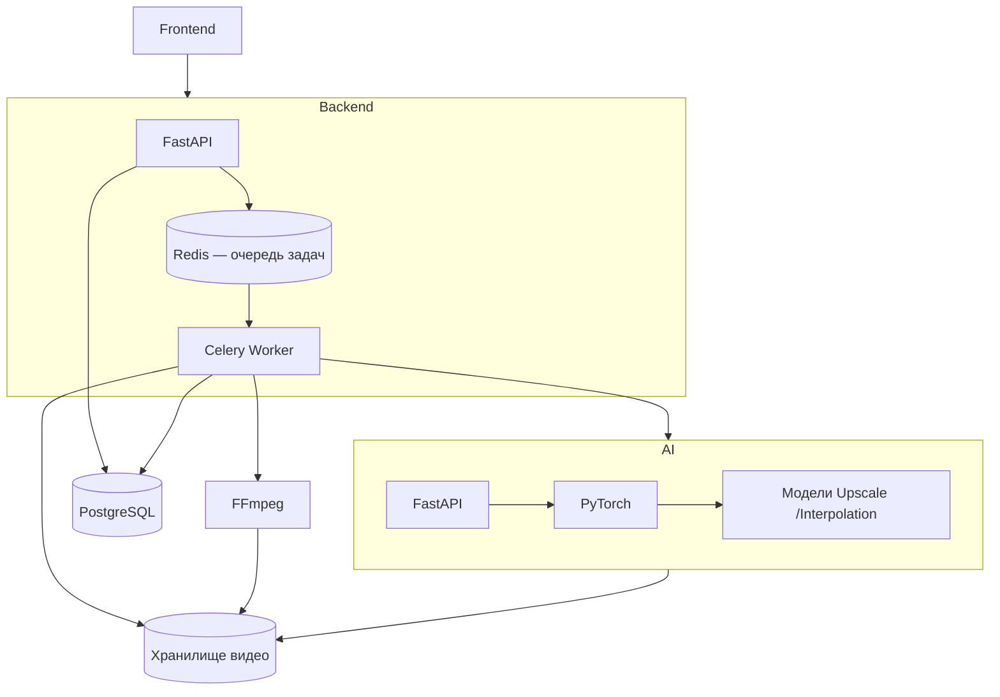
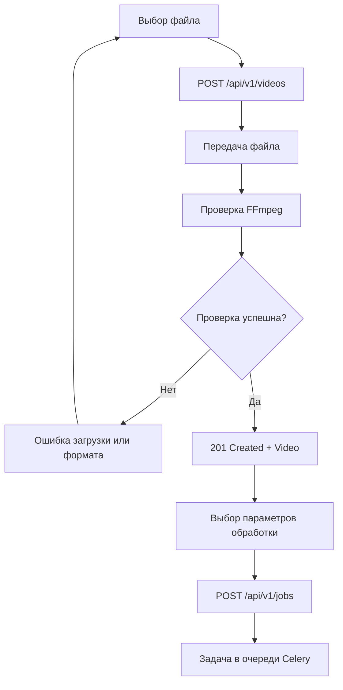
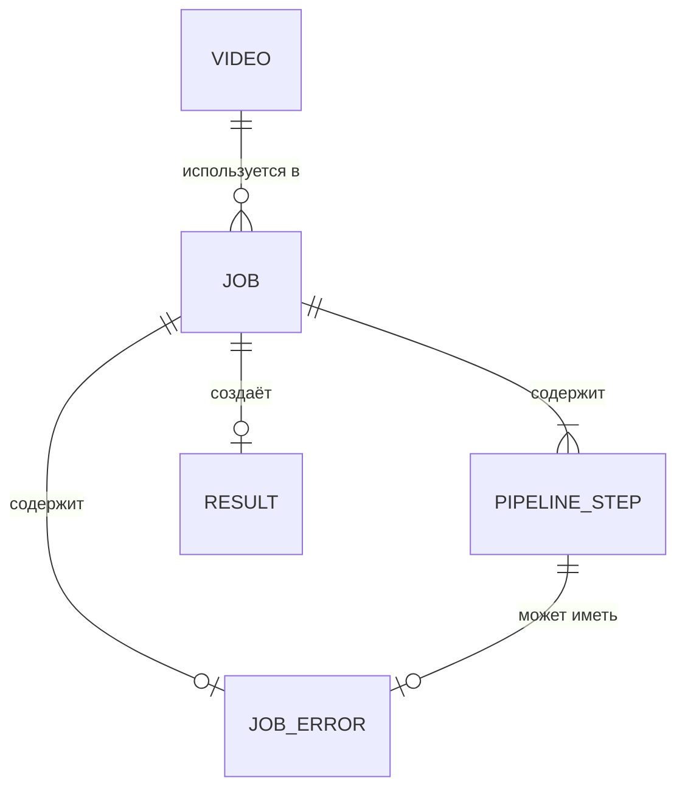

## 1. Общая архитектура приложения



Кто за что отвечает

- **FastAPI Backend** — принимает запрос, валидирует параметры, создаёт задачу и возвращает job_id.
- **Redis** — брокер сообщений, через который Backend передаёт задачи Worker'у ([Подробнее о Redis](https://redis.io/)).
- **Celery Worker** — забирает задачу из очереди и выполняет пайплайн: вызывает FFmpeg, обращается к AI-сервису, проверяет результат и обновляет статус задачи ([Подробнее о Celery](https://docs.celeryq.dev/en/stable/)).
- **AI Service** — отдельный сервис на FastAPI + PyTorch, который выполняет нейросетевую обработку.
- **FFmpeg** — выполняет операции с видео и извлекает метаданные ([Документация FFmpeg](https://ffmpeg.org/documentation.html)).
- **PostgreSQL** — хранит статусы задач и метаданные.
- **Хранилище** — содержит исходные и обработанные видео, временные файлы. По сути, просто диск на сервере (в будущем можно перейти на S3).

---

## 2. Основные сущности

### 2.1. Video — видеофайл

`Video` описывает исходный видеофайл, загруженный пользователем. Видео существует независимо от задач обработки: один файл можно использовать в нескольких `Job`.

| Поле               | Тип               | Обязательное | Описание и назначение                                            |
| ------------------ | ----------------- | ------------ | ---------------------------------------------------------------- |
| `id`               | `UUID`            | Да           | Уникальный идентификатор видео                                   |
| `filename`         | `string`          | Да           | Имя исходного файла                                              |
| `content_type`     | `string`          | Да           | MIME-тип, например `video/mp4`                                   |
| `size_bytes`       | `integer`         | Да           | Размер файла в байтах                                            |
| `duration_seconds` | `number \| null`  | Нет          | Продолжительность видео в секундах                               |
| `width`            | `integer \| null` | Нет          | Ширина кадра в пикселях                                          |
| `height`           | `integer \| null` | Нет          | Высота кадра в пикселях                                          |
| `fps`              | `number \| null`  | Нет          | Частота кадров исходного видео                                   |
| `codec`            | `string \| null`  | Нет          | Видеокодек, например `h264`                                      |
| `created_at`       | `datetime`        | Да           | Время создания в формате ISO 8601 UTC, с суффиксом Z |
| `storage_key`      | `string`          | Внутреннее   | Путь или ключ файла в хранилище; не обязательно отдавать клиенту |

Пример объекта:

```json
{
  "id": "0b3a7a4e-4b11-4c21-8e21-6b43c2b9d011",
  "filename": "source.mp4",
  "content_type": "video/mp4",
  "size_bytes": 52428800,
  "duration_seconds": 32.5,
  "width": 1920,
  "height": 1080,
  "fps": 30,
  "codec": "h264",
  "created_at": "2026-10-11T10:30:00Z"
}
```

`storage_key` — внутреннее поле Backend. Вместо него API может возвращать временную ссылку для скачивания, если это необходимо.

### 2.2. Job — задача обработки

`Job` описывает одну операцию обработки видео или последовательность операций. Задача связывает исходное видео, параметры обработки, этапы выполнения и итоговый результат.

| Поле           | Тип                | Обязательное                               | Описание и назначение                                                                   |
| -------------- | ------------------ | ------------------------------------------ | --------------------------------------------------------------------------------------- |
| `id`           | `UUID`             | Да                                         | Уникальный идентификатор задачи (`job_id`)                                              |
| `video_id`     | `UUID`             | Да                                         | Идентификатор исходного видео                                                           |
| `status`       | `string`           | Да                                         | Текущее состояние задачи                                                                |
| `steps`        | `PipelineStep[]`   | Да                                         | Непустая последовательность операций пайплайна; пустой список запрещён                  |
| `progress`     | `number`           | Нет                                        | Общий прогресс от `0` до `100` (*На будущее - не требуется в MVP*)                      |
| `current_step` | `integer \| null`  | Нет                                        | Индекс текущего этапа, начиная с `0`                                                    |
| `message`      | `string \| null`   | Нет                                        | Краткое описание текущего состояния                                                     |
| `result_id`    | `UUID \| null`     | Да, если `status`=`completed`. Иначе - нет | Идентификатор результата после успешной обработки (`null` если `status` != `completed`) |
| `error`        | `JobError \| null` | Нет                                        | Описание ошибки при неудачном выполнении                                                |
| `created_at`   | `datetime`         | Да                                         | Время создания в формате ISO 8601 UTC, с суффиксом Z                                    |
| `started_at`   | `datetime \| null` | Нет                                        | Время начала обработки в формате ISO 8601 UTC, с суффиксом Z                            |
| `finished_at`  | `datetime \| null` | Нет                                        | Время завершения или остановки в формате ISO 8601 UTC, с суффиксом Z                    |

Статусы `Job`:

|Статус|Значение|
|---|---|
|`queued`|Задача ожидает выполнения в очереди|
|`processing`|Задача выполняется|
|`completed`|Обработка успешно завершена|
|`failed`|Обработка завершилась ошибкой|
|`cancelling`|Запрошена отмена, выполнение ещё останавливается|
|`cancelled`|Задача отменена|

Пример объекта:

```json
{
  "id": "5d78f5b3-3d20-45ac-a48c-29e5e90e51c3",
  "video_id": "0b3a7a4e-4b11-4c21-8e21-6b43c2b9d011",
  "status": "processing",
  "steps": [
    {
      "type": "upscale",
      "status": "completed",
      "parameters": {
        "scale": 2,
        "tile_size": 256
      },
      "progress": 100,
      "started_at": "2026-10-11T10:35:02Z",
      "finished_at": "2026-10-11T10:36:20Z",
      "error": null
    },
    {
      "type": "interpolate",
      "status": "processing",
      "parameters": {
        "target_fps": 60
      },
      "progress": 30,
      "started_at": "2026-10-11T10:36:20Z",
      "finished_at": null,
      "error": null
    }
  ],
  "progress": 65,
  "current_step": 1,
  "message": "Выполняется интерполяция кадров",
  "result_id": null,
  "error": null,
  "created_at": "2026-10-11T10:35:00Z",
  "started_at": "2026-10-11T10:35:02Z",
  "finished_at": null
}
```

### 2.3. PipelineStep — этап обработки

`PipelineStep` описывает отдельную операцию внутри задачи. Например, пользователь может последовательно повысить разрешение видео и увеличить частоту кадров.

| Поле          | Тип                | Обязательное | Описание и назначение                             |
| ------------- | ------------------ | ------------ | ------------------------------------------------- |
| `type`        | `string`           | Да           | Тип операции: `upscale`, `interpolate`, `restore` |
| `status`      | `string`           | Да           | Состояние конкретного этапа                       |
| `parameters`  | `object`           | Да           | Параметры (типы) операции                         |
| `progress`    | `number`           | Да           | Прогресс этапа от `0` до `100`                    |
| `started_at`  | `datetime \| null` | Нет          | Время начала обработки в формате ISO 8601 UTC, с суффиксом Z |
| `finished_at` | `datetime \| null` | Нет          | Время завершения или остановки в формате ISO 8601 UTC, с суффиксом Z |
| `error`       | `JobError \| null` | Нет          | Ошибка этапа, если она произошла                  |

Допустимые типы операций:

| `type`        | Назначение                                                  | Пример параметров    |
| ------------- | ----------------------------------------------------------- | -------------------- |
| `upscale`     | Повышение разрешения видео                                  | `{"scale": 2}`       |
| `interpolate` | Увеличение FPS посредством интерполяции кадров              | `{"target_fps": 60}` |
| `restore`     | Восстановление видео, например уменьшение шума (на будущее) | `{"denoise": true}`  |

Статусы этапа: `queued`, `processing`, `completed`, `failed`, `cancelled`.

Пример:

```json
{
  "type": "upscale",
  "status": "completed",
  "parameters": {
    "scale": 2
  },
  "progress": 100,
  "started_at": "2026-10-11T10:35:02Z",
  "finished_at": "2026-10-11T10:36:20Z",
  "error": null
}
```

`parameters` зависит от типа операции. Backend должен проверять параметры до постановки задачи в очередь, а AI-сервис — повторно проверять их перед выполнением.

### 2.4. Result — результат обработки

`Result` содержит сведения о готовом видео. Сам видеофайл хранится отдельно от записи с метаданными.

| Поле               | Тип                | Обязательное              | Описание и назначение                                   |
| ------------------ | ------------------ | ------------------------- | ------------------------------------------------------- |
| `id`               | `UUID`             | Да                        | Уникальный идентификатор результата                     |
| `job_id`           | `UUID`             | Да                        | Задача, в рамках которой создан результат               |
| `filename`         | `string`           | Да                        | Имя обработанного файла                                 |
| `content_type`     | `string`           | Да                        | MIME-тип результирующего файла                          |
| `size_bytes`       | `integer`          | Да                        | Размер результата в байтах                              |
| `duration_seconds` | `number \| null`   | Нет                       | Продолжительность итогового видео                       |
| `width`            | `integer \| null`  | Нет                       | Ширина итогового кадра                                  |
| `height`           | `integer \| null`  | Нет                       | Высота итогового кадра                                  |
| `fps`              | `number \| null`   | Нет                       | Частота кадров итогового видео                          |
| `download_url`     | `string`           | Да в ответе с результатом | URL эндпоинта скачивания через Backend             |
| `expires_at`       | `datetime \| null` | *На будущее - не требуется в MVP*                       | Время истечения действия ссылки или хранения результата в формате ISO 8601 UTC, с суффиксом Z; *На будущее - не требуется в MVP* |
| `created_at`       | `datetime`         | Да                        | Время создания в формате ISO 8601 UTC, с суффиксом Z |

Пример:

```json
{
  "id": "abfb70e2-2f15-4dc8-92bb-34b5eb777a30",
  "job_id": "5d78f5b3-3d20-45ac-a48c-29e5e90e51c3",
  "filename": "source_enhanced.mp4",
  "content_type": "video/mp4",
  "size_bytes": 73400320,
  "duration_seconds": 32.5,
  "width": 3840,
  "height": 2160,
  "fps": 60,
  "download_url": "/api/v1/jobs/5d78f5b3-3d20-45ac-a48c-29e5e90e51c3/result/download",
  "created_at": "2026-10-11T10:40:00Z"
}
```

### 2.5. JobError — описание ошибки

`JobError` унифицирует ошибки Backend, Worker, FFmpeg и AI-сервиса, чтобы Frontend мог показать понятное сообщение.

Используется только для ошибок выполнения фоновой задачи и этапов; ошибки HTTP-запросов описаны в пункте 3.2. Коды ошибок `JobError` и HTTP-коды — независимые наборы; совпадение названий не означает совпадения контрактов.

| Поле        | Тип              | Обязательное | Описание и назначение                   |
| ----------- | ---------------- | ------------ | --------------------------------------- |
| `code`      | `string`         | Да           | Машиночитаемый код ошибки               |
| `message`   | `string`         | Да           | Краткое описание для пользователя       |
| `stage`     | `string \| null` | Нет          | Этап, на котором возникла ошибка        |
| `retryable` | `boolean`        | Да           | Можно ли безопасно повторить задачу     |
| `details`   | `object \| null` | Нет          | Дополнительные диагностические сведения |

Пример:

```json
{
  "code": "AI_SERVICE_UNAVAILABLE",
  "message": "Сервис обработки видео временно недоступен",
  "stage": "upscale",
  "retryable": true,
  "details": null
}
```

В `details` нельзя возвращать секреты, внутренние токены, содержимое переменных окружения или подробные трассировки исключений.

Коды ошибок:

| Код                      | Значение                              |
| ------------------------ | ------------------------------------- |
| `INVALID_VIDEO_FORMAT`   | Неподдерживаемый формат видео         |
| `VIDEO_TOO_LARGE`        | Файл превышает допустимый размер      |
| `VIDEO_METADATA_ERROR`   | Не удалось прочитать метаданные видео |
| `INVALID_PARAMETERS`     | Некорректные параметры обработки      |
| `VIDEO_NOT_FOUND`        | Видео не найдено                      |
| `JOB_NOT_FOUND`          | Задача не найдена                     |
| `RESULT_NOT_FOUND`       | Результат не найден                   |
| `FFMPEG_ERROR`           | Ошибка обработки средствами FFmpeg    |
| `AI_SERVICE_UNAVAILABLE` | AI-сервис недоступен                  |
| `AI_PROCESSING_ERROR`    | Ошибка нейросетевой обработки         |
| `STORAGE_ERROR`          | Ошибка чтения или записи файла        |
| `INTERNAL_ERROR`         | Внутренняя ошибка сервера             |

### 2.6. ModelResponse 

*На будущее - не требуется в MVP.*

Ответ на `GET /internal/v1/models`. Содержит список доступных моделей обработки видео.

Точная структура зависит от реализации AI-сервиса. Для текущего проекта можно принять следующий вариант:

|Поле|Тип|Обязательное|Описание|
|---|---|---|---|
|`models`|`ModelInfo[]`|Да|Список доступных моделей|

Вложенная сущность `ModelInfo`:

|Поле|Тип|Обязательное|Описание|
|---|---|---|---|
|`name`|`string`|Да|Идентификатор модели, например `realesrgan` или `rife`|
|`operation`|`string`|Да|Тип операции: `upscale` или `interpolate`|
|`available`|`boolean`|Да|Готова ли модель к использованию|

Пример ответа:

```json
{
  "models": [
    {
      "name": "realesrgan",
      "operation": "upscale",
      "available": true
    },
    {
      "name": "rife",
      "operation": "interpolate",
      "available": true
    }
  ]
}
```

### 2.7. AIResult

Результат успешного выполнения операции апскейлинга или интерполяции. Возвращается после завершения обработки.

|Поле|Тип|Обязательное|Описание|
|---|---|---|---|
|`status`|`string`|Да|Итоговый статус операции. Например, `completed`|
|`output_uri`|`string`|Да|Путь к обработанному видео в общем файловом хранилище|
|`size_bytes`|`integer`|Да|Размер выходного файла в байтах|
|`duration_seconds`|`number`|Да|Длительность видео в секундах|
|`width`|`integer`|Да|Ширина видео в пикселях|
|`height`|`integer`|Да|Высота видео в пикселях|
|`fps`|`number`|Да|Частота кадров выходного видео|

Пример:

```json
{
  "status": "completed",
  "output_uri": "/shared/jobs/job_456/upscaled.mp4",
  "size_bytes": 73400320,
  "duration_seconds": 32.5,
  "width": 3840,
  "height": 2160,
  "fps": 30
}
```

`AIResult` одинаков для обеих операций: меняются значения полей, а не структура ответа.

## 3. Общий формат API

### 3.1. Правила

- Пользовательские эндпоинты используют префикс `/api/v1`; внутренние эндпоинты Backend → AI Service используют префикс `/internal/v1`.
- JSON-запросы используют `Content-Type: application/json`.
- Загрузка файлов использует `multipart/form-data`.
- Время передаётся в формате ISO 8601 в UTC с суффиксом `Z`, например `2026-10-11T10:30:00Z`. Все временные поля в примерах и ответах API используют этот формат.
- Идентификаторы передаются в формате UUID.
- Для больших файлов не используется Base64 внутри JSON.
- Обработка видео выполняется асинхронно: создание задачи не означает, что результат уже готов.
- В MVP аутентификация не используется. Все эндпоинты доступны без учётных данных; аутентификация и разграничение доступа между пользователями могут быть добавлены в будущем.

### 3.2. Контракт HTTP-ошибок

Все ошибки пользовательского API, включая ошибки валидации FastAPI, возвращаются в формате ниже. Backend преобразует внутренние ошибки фреймворка в этот контракт; `details` может быть `null`.

Все HTTP-ошибки используют единую JSON-оболочку:

```json
{
  "error": {
    "code": "VALIDATION_ERROR",
    "message": "Переданы некорректные параметры запроса",
    "details": null
  }
}
```

|Поле|Тип|Описание|
|---|---|---|
|`error`|`object`|Объект с информацией об ошибке|
|`error.code`|`string`|Машиночитаемый код ошибки|
|`error.message`|`string`|Краткое описание ошибки|
|`error.details`|`object \| null`|Дополнительная информация, например сведения о поле, вызвавшем ошибку|

HTTP-статус ответа определяется типом ошибки, а не содержимым JSON. Backend должен сохранять корректный статус HTTP и возвращать описанную оболочку для всех ошибок пользовательского API.

#### HTTP-статусы и примеры ответов

##### `401 Unauthorized` — требуется аутентификация

*На будущее - не требуется в MVP.*

Используется, если запрос требует аутентификации, но учётные данные отсутствуют или недействительны.

```json
{
  "error": {
    "code": "UNAUTHORIZED",
    "message": "Требуется аутентификация",
    "details": null
  }
}
```

##### `403 Forbidden` — доступ запрещён

*На будущее - не требуется в MVP.*

Используется, если пользователь аутентифицирован, но не имеет права выполнять операцию.

```json
{
  "error": {
    "code": "FORBIDDEN",
    "message": "Недостаточно прав для выполнения операции",
    "details": null
  }
}
```

##### `404 Not Found` — ресурс не найден

Используется, если видео, задача или результат с указанным идентификатором не существуют либо недоступны вызывающему пользователю.

```json
{
  "error": {
    "code": "RESOURCE_NOT_FOUND",
    "message": "Запрашиваемый ресурс не найден",
    "details": {
      "resource": "video"
    }
  }
}
```

##### `410 Gone` — ресурс больше недоступен

Используется, если ранее существовавший результат удалён или больше не доступен. Код ошибки: `RESOURCE_GONE`.

```json
{
  "error": {
    "code": "RESOURCE_GONE",
    "message": "Результат больше недоступен",
    "details": null
  }
}
```

##### `409 Conflict` — конфликт состояния

Используется, если операция недопустима в текущем состоянии ресурса. Например, повторный запуск задачи, которая ещё выполняется.

```json
{
  "error": {
    "code": "INVALID_STATE",
    "message": "Операция недоступна в текущем состоянии задачи",
    "details": {
      "status": "processing"
    }
  }
}
```

##### `413 Content Too Large` — превышен размер файла

Используется, если размер загружаемого файла превышает установленный лимит.

```json
{
  "error": {
    "code": "VIDEO_TOO_LARGE",
    "message": "Размер видео превышает допустимый лимит",
    "details": {
      "max_size_bytes": 104857600
    }
  }
}
```

##### `415 Unsupported Media Type` — неподдерживаемый формат

Используется, если переданный тип файла не поддерживается API.

```json
{
  "error": {
    "code": "UNSUPPORTED_MEDIA_TYPE",
    "message": "Формат файла не поддерживается",
    "details": {
      "supported_formats": ["mp4", "mov", "webm"]
    }
  }
}
```

##### `422 Unprocessable Entity` — ошибка валидации

Используется, если запрос имеет некорректную структуру или содержит недопустимые значения параметров. Backend преобразует стандартный ответ FastAPI в единый контракт.

```json
{
  "error": {
    "code": "VALIDATION_ERROR",
    "message": "Переданы некорректные параметры запроса",
    "details": {
      "fields": [
        {
          "field": "steps[0].parameters.scale",
          "message": "Значение должно быть равно 2 или 4"
        }
      ]
    }
  }
}
```

`details` может быть `null`, если дополнительные сведения не предоставляются.

##### `500 Internal Server Error` — внутренняя ошибка

Используется при неожиданной ошибке Backend. Ответ не должен содержать трассировки исключений, секреты или внутренние данные сервера.

```json
{
  "error": {
    "code": "INTERNAL_ERROR",
    "message": "Внутренняя ошибка сервера",
    "details": null
  }
}
```

##### `503 Service Unavailable` — сервис временно недоступен

Используется, если Backend временно не может выполнить запрос, например из-за недоступности очереди задач или необходимого внутреннего сервиса.

```json
{
  "error": {
    "code": "SERVICE_UNAVAILABLE",
    "message": "Сервис временно недоступен",
    "details": null
  }
}
```

##### Правила реализации

- Backend должен преобразовывать стандартные ошибки валидации FastAPI, HTTP-исключения и предусмотренные приложением ошибки в единый контракт.
- Для этого следует использовать глобальные обработчики исключений FastAPI и единый механизм формирования ответа.
- Ошибки загрузки файлов, включая превышение лимита размера, должны соответствовать этому контракту, если они обрабатываются пользовательским API.
- Ошибки, возникающие после принятия фоновой задачи, например при обработке через Celery или AI Service, отражаются в `Job.error`. Они не заменяют HTTP-ответ уже завершившегося запроса создания задачи.
- HTTP-статус и `error.code` должны соответствовать фактической причине ошибки.
- Перечисленные коды являются рекомендуемыми идентификаторами контракта и должны быть реализованы в Backend.

## 4. Контракт внешнего API  (Front -> Back)

Какие запросы принимает Бэкэнд со стороны Фронтэнда.

Все ошибки эндпоинтов ниже возвращают JSON-оболочку из пункта 3.2. Столбец `error.code` показывает значение поля `error.code` в этой оболочке.

### 4.1. Сводная таблица эндпоинтов

| Метод    | Endpoint                                | Назначение                                                  | Успешный ответ               | Основные ошибки                   |
| -------- | --------------------------------------- | ----------------------------------------------------------- | ---------------------------- | --------------------------------- |
| `POST`   | `/api/v1/videos`                        | Загрузить и проверить видео, создать `Video`                | `201 Created` — `Video`      | `413`, `415`, `422`, `500`        |
| `GET`    | `/api/v1/videos`                        | Получить список загруженных видео с пагинацией              | `200 OK` — список `Video`    | `422`                             |
| `GET`    | `/api/v1/videos/{video_id}`             | Получить метаданные видео                                   | `200 OK` — `Video`           | `404`, `422`                      |
| `DELETE` | `/api/v1/videos/{video_id}`             | Удалить исходное видео                                      | `204 No Content`             | `404`, `409`, `500`               |
| `POST`   | `/api/v1/jobs`                          | Создать задачу обработки и поставить в очередь Celery       | `202 Accepted` — `Job`       | `404`, `409`, `422`, `503`        |
| `GET`    | `/api/v1/jobs/{job_id}`                 | Получить статус задачи, прогресс и этапы                    | `200 OK` — `Job`             | `404`, `422`                      |
| `POST`   | `/api/v1/jobs/{job_id}/cancel`          | Запросить отмену задачи обработки                           | `200 OK` — `Job`             | `404`, `409`, `422`               |
| `DELETE` | `/api/v1/jobs/{job_id}`                 | Удалить задачу и связанные файлы согласно политике хранения | `204 No Content`             | `404`, `409`, `500`               |
| `POST`   | `/api/v1/jobs/{job_id}/retry`           | Создать повторную задачу на основе завершившейся ошибкой    | `202 Accepted` — новый `Job` | `404`, `409`, `422`, `503`        |
| `GET`    | `/api/v1/jobs/{job_id}/result`          | Получить метаданные результата и ссылку на скачивание       | `200 OK` — `Result`          | `404`, `409`, `410`               |
| `GET`    | `/api/v1/jobs/{job_id}/result/download` | Скачать обработанное видео через Backend                    | `200 OK` — видеофайл         | `404`, `409`, `410`, `422`, `500` |

### 4.2. Сводная таблица параметров

| Endpoint                           | Параметры пути   | Query-параметры   | Тело запроса                  |
| ---------------------------------- | ---------------- | ----------------- | ----------------------------- |
| `POST /api/v1/videos`              | —                | —                 | `multipart/form-data`: `file` |
| `GET /api/v1/videos`               | —                | `limit`, `offset` | —                             |
| `GET /api/v1/videos/{video_id}`    | `video_id: UUID` | —                 | —                             |
| `DELETE /api/v1/videos/{video_id}` | `video_id: UUID` | —                 | —                             |
| `POST /api/v1/jobs`                | —                | —                 | JSON: `video_id`, `steps`     |
| `GET /api/v1/jobs/{job_id}`        | `job_id: UUID`   | —                 | —                             |
| `POST /api/v1/jobs/{job_id}/cancel` | `job_id: UUID` | — | — |
| `DELETE /api/v1/jobs/{job_id}` | `job_id: UUID` | — | — |
| `POST /api/v1/jobs/{job_id}/retry` | `job_id: UUID`   | —                 | —                             |
| `GET /api/v1/jobs/{job_id}/result` | `job_id: UUID`   | —                 | —                             |
| `GET /api/v1/jobs/{job_id}/result/download` | `job_id: UUID` | — | — |
### 4.3 Работа с видео: `/api/v1/videos*`

Эта группа эндпоинтов отвечает за загрузку исходных файлов и управление ими. Создание `Video` не запускает обработку автоматически: для этого клиент отдельно создаёт `Job`.

#### 4.3.1. `POST /api/v1/videos` — загрузка видео

Загружает видеофайл на сервер, проверяет его корректность и создаёт сущность `Video`.

**Тип запроса:** `multipart/form-data`.

|Поле|Тип|Обязательное|Описание|
|---|---|---|---|
|`file`|`file`|Да|Исходный видеофайл|

Пример запроса:

```bash
curl -X POST http://localhost:8000/api/v1/videos \
  -F "file=@source.mp4"
```

##### Последовательность обработки запроса

1. Frontend отправляет файл на Backend.
2. Backend принимает и сохраняет файл во временное или постоянное хранилище.
3. Backend проверяет формат и возможность прочитать видео с помощью FFmpeg, извлекает метаданные.
4. При успешной проверке Backend создаёт запись `Video` и возвращает её клиенту.
5. Frontend разблокирует настройки обработки и позволяет создать `Job`.

>[!WARNING]
>До получения успешного ответа видео нельзя передавать в обработку через `POST /api/v1/jobs`.

В текущей реализации принимаются расширения MP4, MOV и WebM. Файл проверяется установленным `ffprobe`; один только MIME-тип, переданный клиентом, не считается проверкой содержимого.

##### Успешный ответ

HTTP-статус: `201 Created`.

Тело ответа содержит объект `Video`:

```json
{
  "id": "0b3a7a4e-4b11-4c21-8e21-6b43c2b9d011",
  "filename": "source.mp4",
  "content_type": "video/mp4",
  "size_bytes": 52428800,
  "duration_seconds": 32.5,
  "width": 1920,
  "height": 1080,
  "fps": 30,
  "codec": "h264",
  "created_at": "2026-10-11T10:30:00Z"
}
```

##### Ошибки

| HTTP-статус                  | Причина                                                                                  | error.code               |
| ---------------------------- | ---------------------------------------------------------------------------------------- | ------------------------ |
| `413 Content Too Large`      | Превышен допустимый размер файла                                                         | `VIDEO_TOO_LARGE`        |
| `415 Unsupported Media Type` | Неподдерживаемый тип файла                                                               | `UNSUPPORTED_MEDIA_TYPE` |
| `422 Unprocessable Entity`   | Файл не передан, запрос некорректен, либо файл не является читаемым поддерживаемым видео | `VALIDATION_ERROR`       |
| `500 Internal Server Error`  | Ошибка сохранения файла или внутренняя ошибка Backend                                    | `INTERNAL_ERROR`         |

>[!ATTENTION]
>При неудачной загрузке или проверке Backend не должен создавать доступную для обработки запись `Video`. Временные файлы необходимо удалить.

##### Поведение Frontend

Во время передачи файла Frontend отображает прогресс загрузки, если используемый HTTP-клиент позволяет его отслеживать. До успешного ответа настройки обработки и запуск `Job` для этого файла недоступны.

После ответа `201 Created` Frontend сохраняет полученный `video_id` и разрешает пользователю выбирать параметры обработки.

Если запрос завершился ошибкой, Frontend показывает сообщение и позволяет повторить загрузку.

##### Диаграмма



#### 4.3.2. `GET /api/v1/videos` — список видео

Возвращает список загруженных видео. Пагинация рекомендуется даже для MVP, чтобы список не становился неограниченным.

Параметры строки запроса:

|Параметр|Тип|Обязательное|Назначение|
|---|---|---|---|
|`limit`|`integer`|Нет|Количество элементов на странице|
|`offset`|`integer`|Нет|Количество пропускаемых элементов|

Рекомендуемые значения по умолчанию: `limit=20`, `offset=0`. Максимальное значение `limit` должно ограничиваться сервером.

Пример:

```http
GET /api/v1/videos?limit=20&offset=0
```

Успешный ответ: `200 OK`.

```json
{
  "items": [
    {
      "id": "0b3a7a4e-4b11-4c21-8e21-6b43c2b9d011",
      "filename": "source.mp4",
      "content_type": "video/mp4",
      "size_bytes": 52428800,
      "duration_seconds": 32.5,
      "width": 1920,
      "height": 1080,
      "fps": 30,
      "codec": "h264",
      "created_at": "2026-10-11T10:30:00Z"
    }
  ],
  "total": 1,
  "limit": 20,
  "offset": 0
}
```

Варианты ошибок:

| HTTP-статус | Причина | error.code |
|---|---|---|
| `422 Unprocessable Entity` | Некорректные значения `limit` или `offset` | `VALIDATION_ERROR` |

#### 4.3.3. `GET /api/v1/videos/{video_id}` — получение метаданных видео

Возвращает информацию об одном загруженном видео.

Пример:

```http
GET /api/v1/videos/0b3a7a4e-4b11-4c21-8e21-6b43c2b9d011
```

Успешный ответ: `200 OK`. Тело ответа — объект `Video`.

Варианты ошибок:

| HTTP-статус | Причина | error.code |
|---|---|---|
| `404 Not Found` | Видео не найдено | `RESOURCE_NOT_FOUND` |
| `422 Unprocessable Entity` | Некорректный формат UUID | `VALIDATION_ERROR` |

#### 4.3.4. `DELETE /api/v1/videos/{video_id}` — удаление видео

Удаляет исходный файл и его запись, если это допускает состояние системы.

Пример:

```http
DELETE /api/v1/videos/0b3a7a4e-4b11-4c21-8e21-6b43c2b9d011
```

Успешный ответ: `204 No Content`.

Рекомендуемые ограничения:

- Нельзя удалять видео, которое используется выполняющейся задачей, без явного механизма отмены или безопасного сохранения файла до окончания обработки.
- В текущей реализации видео нельзя удалить, пока с ним связана хотя бы одна задача; сначала удалите связанные задачи. Автоматическое каскадное удаление истории задач и результатов не выполняется.
- При использовании объектного хранилища удаление файла и удаление записи в БД должны обрабатываться с учётом возможных частичных ошибок.

Варианты ошибок:

| HTTP-статус | Причина | error.code |
|---|---|---|
| `404 Not Found` | Видео не найдено | `RESOURCE_NOT_FOUND` |
| `409 Conflict` | Видео используется активной задачей | `INVALID_STATE` |
| `500 Internal Server Error` | Не удалось завершить удаление | `INTERNAL_ERROR` |

---

### 4.4. Создание и получение задач: `/api/v1/jobs*`

#### 4.4.1. `POST /api/v1/jobs` — создание задачи обработки

Создаёт задачу на основе ранее загруженного видео и ставит её в очередь.

**Тип запроса:** `application/json`.

Формат запроса:

| Поле       | Тип                   | Обязательное | Назначение                    |
| ---------- | --------------------- | ------------ | ----------------------------- |
| `video_id` | `UUID`                | Да           | Идентификатор исходного видео |
| `steps`    | `PipelineStepInput[]` | Да           | Список операций обработки     |

В качестве `video_id` допускается только идентификатор ранее загруженного и успешно проверенного видео. Если видео отсутствует или недоступно для обработки, Backend возвращает `404 Not Found` или `409 Conflict` соответственно.

Для входного объекта `PipelineStepInput` используются поля `type` и `parameters`. Поля состояния, прогресса, времени выполнения и ошибок клиент не задаёт — ими управляет Backend.

Пример запроса:

```json
{
  "video_id": "0b3a7a4e-4b11-4c21-8e21-6b43c2b9d011",
  "steps": [
    {
      "type": "upscale",
      "parameters": {
	      "scale": 2
      }
    },
    {
      "type": "interpolate",
      "parameters": {
        "target_fps": 60
      }
    }
  ]
}
```

Успешный ответ: `202 Accepted`.

```json
{
  "id": "5d78f5b3-3d20-45ac-a48c-29e5e90e51c3",
  "video_id": "0b3a7a4e-4b11-4c21-8e21-6b43c2b9d011",
  "status": "queued",
  "steps": [
    {
      "type": "upscale",
      "status": "queued",
      "parameters": {
        "scale": 2
      },
      "progress": 0,
      "started_at": null,
      "finished_at": null,
      "error": null
    },
    {
      "type": "interpolate",
      "status": "queued",
      "parameters": {
        "target_fps": 60
      },
      "progress": 0,
      "started_at": null,
      "finished_at": null,
      "error": null
    }
  ],
  "progress": 0,
  "current_step": null,
  "message": "Задача добавлена в очередь",
  "result_id": null,
  "error": null,
  "created_at": "2026-10-11T10:35:00Z",
  "started_at": null,
  "finished_at": null
}
```

Варианты ошибок:

| HTTP-статус | Причина | error.code |
|---|---|---|
| `404 Not Found` | Видео с указанным `video_id` не найдено | `RESOURCE_NOT_FOUND` |
| `409 Conflict` | Видео недоступно для обработки в текущем состоянии | `INVALID_STATE` |
| `422 Unprocessable Entity` | Пустой список этапов или недопустимые параметры | `VALIDATION_ERROR` |
| `503 Service Unavailable` | Очередь задач недоступна | `SERVICE_UNAVAILABLE` |

#### 4.4.2. `GET /api/v1/jobs/{job_id}` — получение статуса задачи

Возвращает `Job` - текущее состояние задачи, её этапы, прогресс и сведения об ошибке.

Пример:

```http
GET /api/v1/jobs/5d78f5b3-3d20-45ac-a48c-29e5e90e51c3
```

Успешный ответ: `200 OK`. Тело ответа — объект `Job`.

Frontend может периодически запрашивать этот эндпоинт, пока `status` не станет одним из терминальных значений: `completed`, `failed` или `cancelled`.

Варианты ошибок:

| HTTP-статус | Причина | error.code |
|---|---|---|
| `404 Not Found` | Задача не найдена | `RESOURCE_NOT_FOUND` |
| `422 Unprocessable Entity` | Некорректный формат UUID | `VALIDATION_ERROR` |

#### 4.4.3. `POST /api/v1/jobs/{job_id}/cancel` — отмена задачи

Отправляет запрос на отмену задачи обработки видео. Для удаления задачи используется отдельный эндпоинт `DELETE /api/v1/jobs/{job_id}`.

Параметры пути:

|Параметр|Тип|Описание|
|---|---|---|
|`job_id`|`UUID`|Идентификатор отменяемой задачи|

Тело запроса отсутствует.

##### Логика работы

- Если задача находится в статусе `queued`, Backend удаляет её из очереди либо помечает отменённой, чтобы Worker не начал выполнение.
- Если задача находится в статусе `processing`, Backend переводит её в `cancelling` и передаёт сигнал Worker.
- После остановки обработки задача получает статус `cancelled`.
- Если задача уже находится в статусе `cancelling`, повторный запрос не отправляет новый сигнал и возвращает её текущий объект `Job` со статусом `cancelling`.
- Если задача уже находится в статусе `cancelled`, повторный запрос возвращает текущий объект `Job` без изменений.
- Если задача завершилась со статусом `completed` или `failed`, отмена невозможна и Backend возвращает `409 Conflict`.

Отмена не всегда происходит мгновенно: Worker должен остановить текущую операцию, завершить дочерние процессы FFmpeg и освободить ресурсы.

Успешный ответ: `200 OK`. Тело ответа — полный объект `Job` со статусом `cancelling` или `cancelled`.

| HTTP-статус | Причина | error.code |
|---|---|---|
| `200 OK` | Запрос отмены принят либо задача уже имеет статус `cancelling` или `cancelled`; тело — текущий полный объект `Job` | `—` |
| `404 Not Found` | Задача не найдена | `RESOURCE_NOT_FOUND` |
| `409 Conflict` | Задача завершилась со статусом `completed` или `failed` и не может быть отменена | `INVALID_STATE` |
| `422 Unprocessable Entity` | Некорректный формат `job_id` | `VALIDATION_ERROR` |

#### 4.4.4. `DELETE /api/v1/jobs/{job_id}` — удаление задачи

Удаляет задачу. Для отмены задачи используется `POST /api/v1/jobs/{job_id}/cancel`. Активную задачу удалить нельзя.

Успешный ответ: `204 No Content`.

Варианты ошибок:

| HTTP-статус | Причина | error.code |
|---|---|---|
| `404 Not Found` | Задача не найдена | `RESOURCE_NOT_FOUND` |
| `409 Conflict` | Задача выполняется и не может быть удалена | `INVALID_STATE` |
| `500 Internal Server Error` | Не удалось удалить задачу или связанные файлы | `INTERNAL_ERROR` |

---

#### 4.4.5. `POST /api/v1/jobs/{job_id}/retry`

Создаёт повторную задачу на основе параметров ранее завершившейся с ошибкой задачи.

Параметры пути:

|Параметр|Тип|Описание|
|---|---|---|
|`job_id`|`UUID`|Идентификатор задачи, которую требуется повторить|

Тело запроса отсутствует: Backend использует исходные `video_id` и `steps` из предыдущей задачи.

##### Логика работы

1. Backend проверяет существование исходной задачи и наличие исходного видео.
2. Проверяет, что задача завершилась со статусом `failed`.
3. Проверяет, что поле `JobError.retryable` = `true`.
4. Создаёт новую задачу с новым `job_id`, копируя параметры обработки.
5. Ставит новую задачу в очередь и возвращает её объект.

Рекомендуемый вариант — создавать новую задачу, а не сбрасывать старую. Так сохраняется история ошибок и можно сравнивать результаты повторных попыток.

Успешный ответ: `202 Accepted`. Тело ответа — полный объект нового `Job`, включая скопированные `steps`. Новая задача получает новый `id`, исходная задача не изменяется.

```json
{
  "id": "8a25f80c-a129-4b8d-9020-4e81ed6a12af",
  "video_id": "0b3a7a4e-4b11-4c21-8e21-6b43c2b9d011",
  "status": "queued",
  "steps": [
    {
      "type": "upscale",
      "status": "queued",
      "parameters": {
        "scale": 2,
        "tile_size": 256
      },
      "progress": 0,
      "started_at": null,
      "finished_at": null,
      "error": null
    }
  ],
  "progress": 0,
  "current_step": null,
  "message": "Повторная задача добавлена в очередь",
  "result_id": null,
  "error": null,
  "created_at": "2026-10-11T10:45:00Z",
  "started_at": null,
  "finished_at": null
}
```

| HTTP-статус                | Причина                                                                 | error.code            |
| -------------------------- | ----------------------------------------------------------------------- | --------------------- |
| `404 Not Found`            | Исходная задача или видео не найдены                                    | `RESOURCE_NOT_FOUND`  |
| `409 Conflict`             | Задача не завершилась с ошибкой либо повтор запрещён текущим состоянием | `INVALID_STATE`       |
| `422 Unprocessable Entity` | Некорректный формат `job_id`                                            | `VALIDATION_ERROR`    |
| `503 Service Unavailable`  | Очередь задач недоступна                                                | `SERVICE_UNAVAILABLE` |

#### 4.4.6. `GET /api/v1/jobs/{job_id}/result` — получение результата

Возвращает `Result` - сведения о готовом видео и ссылку на скачивание.

Пример:

```http
GET /api/v1/jobs/5d78f5b3-3d20-45ac-a48c-29e5e90e51c3/result
```

Успешный ответ: `200 OK`.

```json
{
  "id": "abfb70e2-2f15-4dc8-92bb-34b5eb777a30",
  "job_id": "5d78f5b3-3d20-45ac-a48c-29e5e90e51c3",
  "filename": "source_enhanced.mp4",
  "content_type": "video/mp4",
  "size_bytes": 73400320,
  "duration_seconds": 32.5,
  "width": 3840,
  "height": 2160,
  "fps": 60,
  "download_url": "/api/v1/jobs/5d78f5b3-3d20-45ac-a48c-29e5e90e51c3/result/download",
  "created_at": "2026-10-11T10:40:00Z"
}
```

Варианты ошибок:

| HTTP-статус | Причина | error.code |
|---|---|---|
| `404 Not Found` | Задача или результат не найдены | `RESOURCE_NOT_FOUND` |
| `409 Conflict` | Обработка ещё не завершена | `INVALID_STATE` |
| `410 Gone` | Результат удалён или больше недоступен | `RESOURCE_GONE` |

Поле `download_url` указывает на `GET /api/v1/jobs/{job_id}/result/download`. В MVP Backend передаёт видеофайл с диска клиенту потоком; путь к файлу на диске клиенту не раскрывается.

#### 4.4.7. `GET /api/v1/jobs/{job_id}/result/download` — скачивание видео

Возвращает обработанное видео, передавая файл с диска через Backend потоком. Путь к файлу на диске клиенту не раскрывается.

Успешный ответ: `200 OK`. Тело ответа — бинарное содержимое видео. Backend устанавливает заголовки:
- `Content-Type` — MIME-тип из `Result.content_type`.
- `Content-Disposition: attachment; filename="..."` — имя файла из `Result.filename`.
- `Content-Length` — размер файла в байтах, если он известен.

Варианты ошибок; тело каждого ответа использует общую JSON-оболочку из пункта 3.2:

| HTTP-статус                 | Причина                                     | error.code           |
| --------------------------- | ------------------------------------------- | -------------------- |
| `404 Not Found`             | Задача или результат не найдены             | `RESOURCE_NOT_FOUND` |
| `409 Conflict`              | Обработка ещё не завершена                  | `INVALID_STATE`      |
| `410 Gone`                  | Результат или файл больше недоступен        | `RESOURCE_GONE`      |
| `422 Unprocessable Entity`  | Некорректный формат `job_id`                | `VALIDATION_ERROR`   |
| `500 Internal Server Error` | Backend не смог прочитать или передать файл | `INTERNAL_ERROR`     |

---

## 5. Контракт внутреннего API: Backend → AI Service

Какие запросы принимает AI-сервис от Бэкэнда.

### 5.1. Сводная таблица эндпоинтов внутреннего API

| Метод  | Endpoint                   | Назначение                                                                                     | Успешный ответ               | Основные ошибки                   |
| ------ | -------------------------- | ---------------------------------------------------------------------------------------------- | ---------------------------- | --------------------------------- |
| `GET`  | `/internal/v1/health`      | Проверить доступность AI Service                                                               | `200 OK` — `{"status":"ok"}` |                                   |
| `GET`  | `/internal/v1/models`      | Получить список доступных моделей и поддерживаемых режимов (*на будущее - не требуется в MVP*) | `200 OK` — `ModelsResponse`  |                                   |
| `POST` | `/internal/v1/upscale`     | Повысить разрешение видео с помощью нейросети                                                  | `200 OK` — `AIResult`        | `400`, `404`, `422`, `500`, `503` |
| `POST` | `/internal/v1/interpolate` | Увеличить FPS посредством интерполяции кадров                                                  | `200 OK` — `AIResult`        | `400`, `404`, `422`, `500`, `503` |

#### 5.1.1. Формат ошибок внутреннего API

AI Service возвращает ошибки в той же JSON-оболочке, что и пользовательский API в пункте 3.2: `{"error":{"code":"...","message":"...","details":{...}}}`. Набор `code` для внутреннего API отдельный: приведённые в описаниях методах коды не являются кодами пользовательского API или `JobError`. Ответ имеет `Content-Type: application/json`. Поле `details` может отсутствовать, если дополнительных сведений нет; оно не должно содержать секреты, внутренние трассировки или содержимое файлов.

Пример ответа при некорректном параметре:

```json
{
	"error": {
		"code": "VALIDATION_ERROR",
		"message": "Параметр scale должен быть равен 2 или 4",
		"details": {
			"field": "params.scale"
		}
	}
}
```

Backend использует `error.code` и `error.message` при обработке ответа AI Service. Если ошибка приводит к завершению задачи со статусом `failed`, Backend сохраняет соответствующую причину в `Job.error` согласно пункту 2.5; коды внутреннего API при этом не подменяют коды `JobError`.

### 5.2. Сводная таблица параметров

| Endpoint                        | Параметры пути | Query-параметры | Тело запроса                              |
| ------------------------------- | -------------- | --------------- | ----------------------------------------- |
| `GET /internal/v1/health`       | —              | —               | —                                         |
| `GET /internal/v1/models`       | —              | —               | —                                         |
| `POST /internal/v1/upscale`     | —              | —               | JSON: `input_uri`, `output_uri`, `params` |
| `POST /internal/v1/interpolate` | —              | —               | JSON: `input_uri`, `output_uri`, `params` |

### 5.3. Сводная таблица полей запросов и ответов

#### Запросы на обработку

Worker и AI Service используют общую файловую систему с одинаковыми путями к файлам. Пути `input_uri` и `output_uri` должны быть доступны обоим сервисам.

| Поле         | Тип      | Обязательное | Назначение                              |
| ------------ | -------- | ------------ | --------------------------------------- |
| `input_uri`  | `string` | Да           | Путь к исходному видео в общей файловой системе, доступной Worker и AI Service |
| `output_uri` | `string` | Да           | Путь для сохранения видео в общей файловой системе, доступной Worker и AI Service |
| `params`     | `object` | Да           | Параметры операции                      |

Выбор модели не является частью запроса: AI Service автоматически выбирает модель по типу операции и своей конфигурации. Параметры `params` зависят от операции:

| Операция      | Поле         | Тип               | Назначение                                              |
| ------------- | ------------ | ----------------- | ------------------------------------------------------- |
| `upscale`     | `scale`      | `integer`         | Коэффициент увеличения разрешения, например `2` или `4` |
| `upscale`     | `tile_size`  | `integer \| null` | Размер обрабатываемого фрагмента изображения            |
| `interpolate` | `target_fps` | `number`          | Целевая частота кадров                                  |

#### Ответ `AIResult`

|Поле|Тип|Назначение|
|---|---|---|
|`status`|`string`|Результат выполнения; при успехе — `completed`|
|`output_uri`|`string`|Путь к обработанному видео|
|`size_bytes`|`integer`|Размер итогового файла в байтах|
|`duration_seconds`|`number`|Продолжительность итогового видео в секундах|
|`width`|`integer`|Ширина итогового видео в пикселях|
|`height`|`integer`|Высота итогового видео в пикселях|
|`fps`|`number`|Частота кадров итогового видео|

### 5.4. `POST /internal/v1/upscale`

Повышает разрешение видео и возвращает метаданные готового результата после завершения инференса.

Запрос (`application/json`):

```json
{
  "input_uri": "/shared/jobs/job_456/input.mp4",
  "output_uri": "/shared/jobs/job_456/upscaled.mp4",
  "params": {
    "scale": 2,
    "tile_size": 256
  }
}
```

Ответ (`200 OK`):

```json
{
  "status": "completed",
  "output_uri": "/shared/jobs/job_456/upscaled.mp4",
  "size_bytes": 73400320,
  "duration_seconds": 32.5,
  "width": 3840,
  "height": 2160,
  "fps": 30
}
```

| HTTP-статус | `error.code` | Условие |
|---|---|---|
| `400 Bad Request` | `INVALID_REQUEST` | Некорректная структура запроса. |
| `404 Not Found` | `INPUT_NOT_FOUND` | Не найден входной файл из `input_uri`. |
| `422 Unprocessable Entity` | `VALIDATION_ERROR` | Некорректны или не поддерживаются параметры, например `params.scale` или `params.tile_size`. |
| `500 Internal Server Error` | `AI_PROCESSING_ERROR` | Ошибка во время обработки видео. |
| `503 Service Unavailable` | `AI_SERVICE_UNAVAILABLE` | AI Service временно недоступен. |

### 5.5. `POST /internal/v1/interpolate`

Увеличивает частоту кадров видео с помощью нейросетевой интерполяции.

Запрос:

```json
{
  "input_uri": "/shared/jobs/job_456/upscaled.mp4",
  "output_uri": "/shared/jobs/job_456/interpolated.mp4",
  "params": {
    "target_fps": 60
  }
}
```

Ответ (`200 OK`):

```json
{
  "status": "completed",
  "output_uri": "/shared/jobs/job_456/interpolated.mp4",
  "size_bytes": 82000000,
  "duration_seconds": 32.5,
  "width": 3840,
  "height": 2160,
  "fps": 60
}
```

| HTTP-статус                 | `error.code`             | Условие                                                         |
| --------------------------- | ------------------------ | --------------------------------------------------------------- |
| `400 Bad Request`           | `INVALID_REQUEST`        | Некорректная структура запроса.                                 |
| `404 Not Found`             | `INPUT_NOT_FOUND`        | Не найден входной файл из `input_uri`.                          |
| `422 Unprocessable Entity`  | `VALIDATION_ERROR`       | Некорректен или не поддерживается параметр `params.target_fps`. |
| `500 Internal Server Error` | `AI_PROCESSING_ERROR`    | Ошибка во время интерполяции видео.                             |
| `503 Service Unavailable`   | `AI_SERVICE_UNAVAILABLE` | AI Service временно недоступен.                                 |

Важно: HTTP-запрос остаётся открытым, пока выполняется нейросетевая обработка. Нужно настроить таймауты и ограничить размер обрабатываемых видео.

## 6. Связи сущностей

- Один `Video` может использоваться в нескольких `Job`.
- Каждый `Job` ссылается на один исходный `Video`.
- Один `Job` содержит упорядоченный список `PipelineStep`.
- Успешный `Job` должен иметь один `Result`.
- Неудачный `Job` может иметь `JobError`; ошибка также может относиться к конкретному этапу `PipelineStep`.

Схематично:




---

## 7. Дополнительно

[Подробная диаграмма последовательности пользовательских сценариев](api_sequence_diagram.md)
