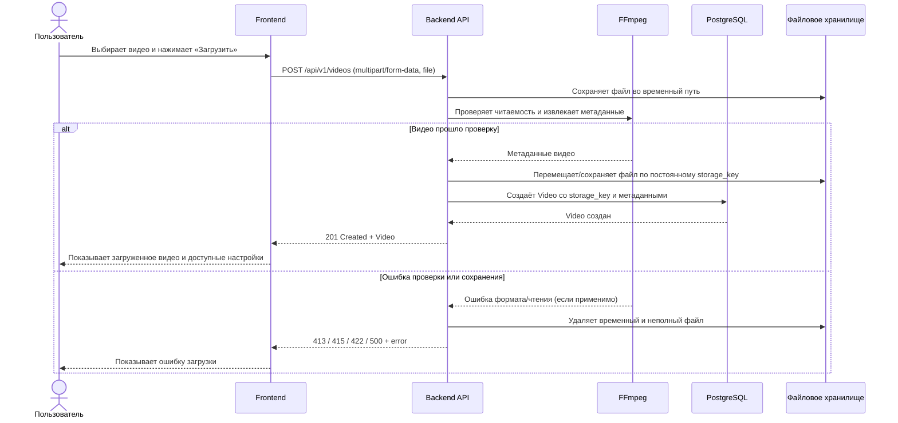
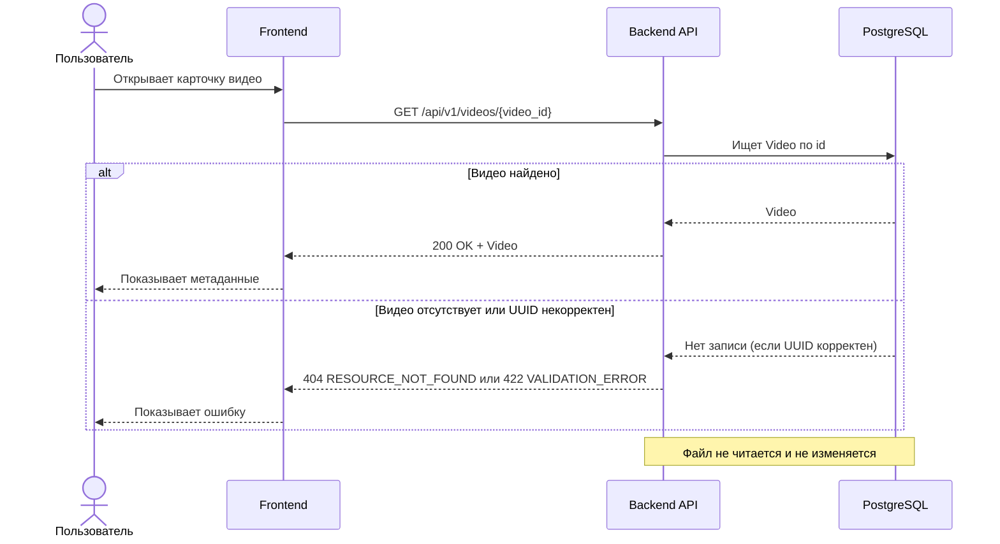
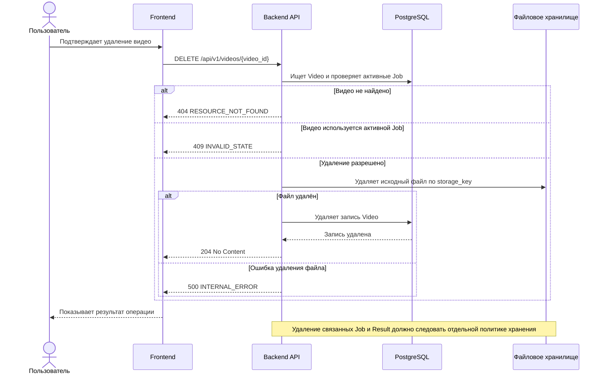
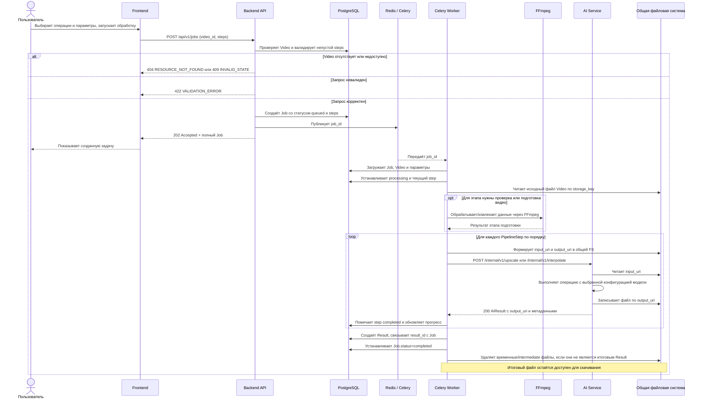
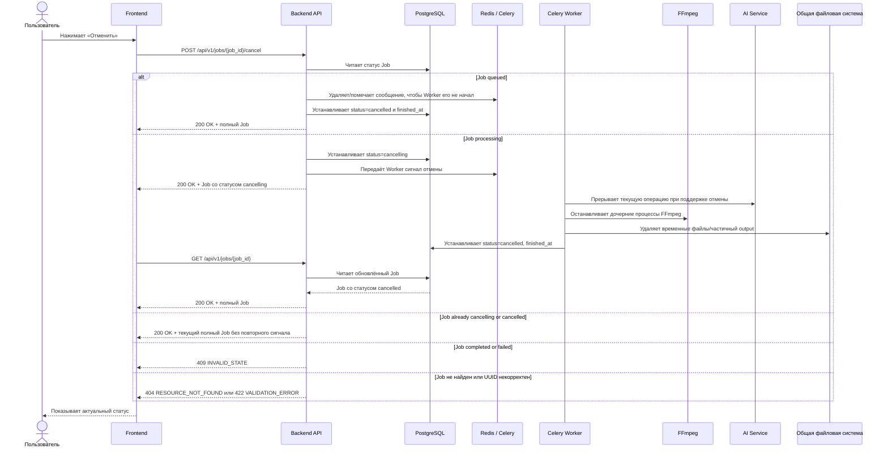
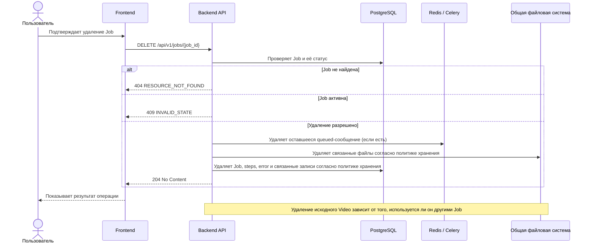
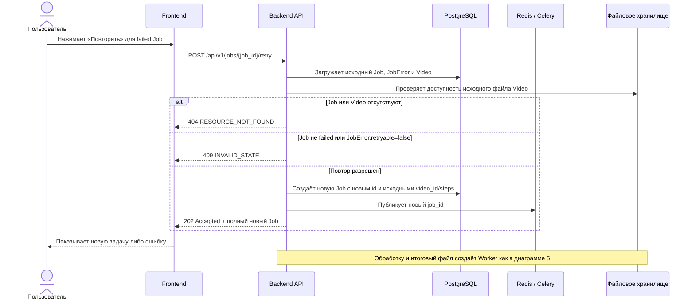

# API и sequence diagram пользовательских сценариев

Диаграммы ниже описывают путь от действия пользователя во Frontend до изменений в Backend, очереди, Worker, AI Service, БД и файловой системе. Состояния и ответы соответствуют разделу 4 документа [api.md](api.md).

## 1. Загрузка видео — 4.3.1



## 2. Просмотр списка видео — 4.3.2

```mermaid
sequenceDiagram
    actor User as Пользователь
    participant Front as Frontend
    participant API as Backend API
    participant DB as PostgreSQL

    User->>Front: Открывает список видео
    Front->>API: GET /api/v1/videos?limit=20&offset=0
    alt limit и offset корректны
        API->>DB: Читает страницу Video и общее количество
        DB-->>API: Список метаданных и total
        API-->>Front: 200 OK + items, total, limit, offset
        Front-->>User: Показывает список
    else Ошибка параметров пагинации
        API-->>Front: 422 VALIDATION_ERROR
        Front-->>User: Показывает ошибку запроса
    end
    Note over API,DB: Файлы не читаются; файловая система не меняется
```

## 3. Просмотр метаданных видео — 4.3.3



## 4. Удаление видео — 4.3.4



## 5. Создание Job и обработка видео — 4.4.1



Если обработка завершается ошибкой, Worker сохраняет `Job.error`, помечает текущий этап/задачу как `failed` и удаляет временные файлы, если это безопасно. Клиент получает состояние через `GET /api/v1/jobs/{job_id}` (диаграмма 6).

## 6. Опрос статуса Job — 4.4.2

```mermaid
sequenceDiagram
    actor User as Пользователь
    participant Front as Frontend
    participant API as Backend API
    participant DB as PostgreSQL

    loop Пока Job не в терминальном статусе
        Front->>API: GET /api/v1/jobs/{job_id}
        API->>DB: Читает Job и PipelineStep
        alt Job найдена и UUID корректен
            DB-->>API: Текущее состояние
            API-->>Front: 200 OK + полный Job
            Front-->>User: Показывает status, текущий этап и progress (если доступен)
        else Job не найдена или UUID некорректен
            API-->>Front: 404 RESOURCE_NOT_FOUND или 422 VALIDATION_ERROR
            Front-->>User: Показывает ошибку
        end
    end
    Note over Front,API: Опрос прекращается при completed, failed или cancelled
    Note over API,DB: Запрос только читает БД; файлы не затрагиваются
```

## 7. Отмена Job — 4.4.3



## 8. Удаление Job — 4.4.4



## 9. Повторная постановка Job — 4.4.5



## 10. Получение метаданных результата — 4.4.6

```mermaid
sequenceDiagram
    actor User as Пользователь
    participant Front as Frontend
    participant API as Backend API
    participant DB as PostgreSQL

    User->>Front: Открывает готовый результат
    Front->>API: GET /api/v1/jobs/{job_id}/result
    API->>DB: Проверяет Job.status и загружает Result
    alt Job completed и Result существует
        DB-->>API: Result metadata
        API-->>Front: 200 OK + Result и download_url
        Front-->>User: Показывает сведения и кнопку скачивания
    else Job не завершена
        API-->>Front: 409 INVALID_STATE
    else Job или Result отсутствуют
        API-->>Front: 404 RESOURCE_NOT_FOUND
    else Result больше недоступен
        API-->>Front: 410 RESOURCE_GONE
    end
    Note over API,DB: Файл не читается; файловая система не меняется
```

## 11. Скачивание результата — 4.4.7

```mermaid
sequenceDiagram
    actor User as Пользователь
    participant Front as Frontend
    participant API as Backend API
    participant DB as PostgreSQL
    participant FS as Файловое хранилище

    User->>Front: Нажимает «Скачать»
    Front->>API: GET /api/v1/jobs/{job_id}/result/download
    API->>DB: Проверяет Job и загружает Result
    alt Result доступен
        DB-->>API: storage_key, filename, content_type, size_bytes
        API->>FS: Открывает итоговый файл для потокового чтения
        alt Файл прочитан
            FS-->>API: Поток байтов
            API-->>Front: 200 OK + video stream и Content-Disposition
            Front-->>User: Сохраняет файл
        else Файл отсутствует или чтение завершилось ошибкой
            API-->>Front: 410 RESOURCE_GONE или 500 INTERNAL_ERROR
        end
    else Job не найдена / UUID невалиден / результат ещё не готов
        API-->>Front: 404 / 422 / 409 с JSON error
    end
    Note over API,FS: Путь хранения не раскрывается клиенту; Backend передаёт файл потоком
```

[Главная страница](api.md)

